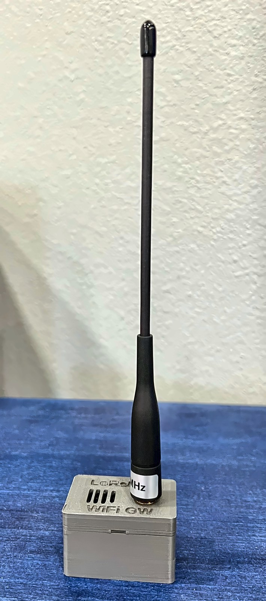
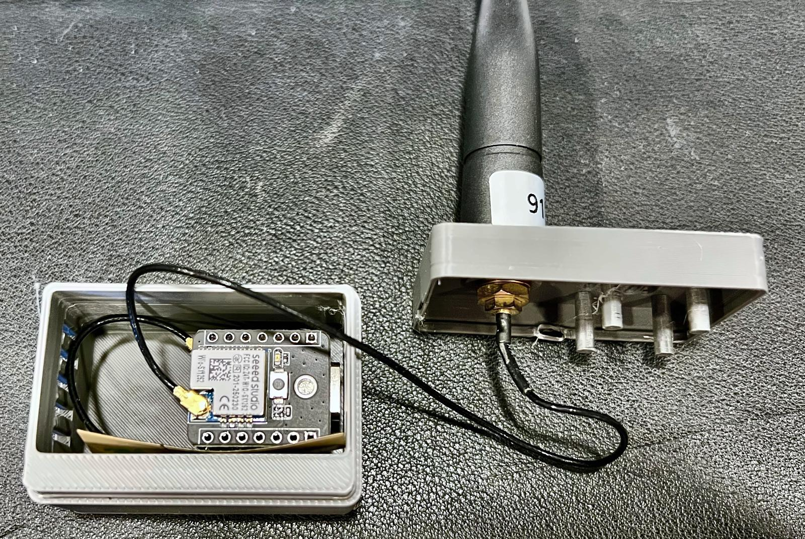
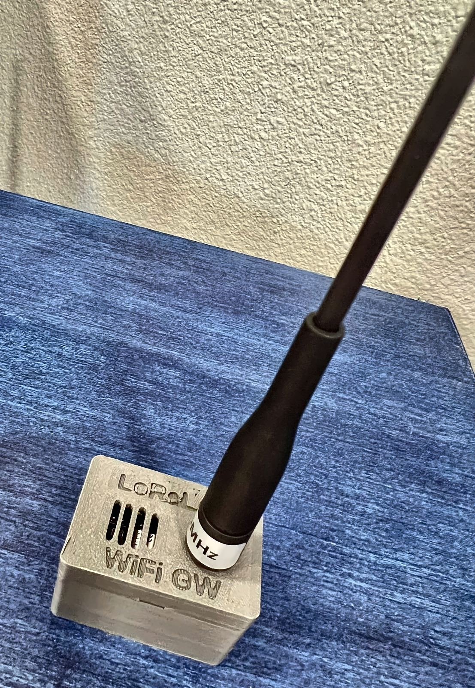

# LoRaLAN WiFi Gateway

MicroPython LoRa-to-Wi-Fi gateway for a Seeed XIAO ESP32-S3 and a Wio-SX1262. It listens for LoRaLAN sensor packets on 915 MHz, ACKs each one, and publishes it over Wi-Fi to an MQTT broker in the same JSON format the [Lora to Ethernet Bridge](https://github.com/scottlecomte/Lora-to-Ethernet-Bridge) sends Node-RED. No cloud account, no subscription, no outside server.



## Part of LoRaLAN

This gateway is one piece of [LoRaLAN](https://github.com/scottlecomte/LoRaLAN), a local LoRa sensor network that stays on your LAN. The sensor nodes send RadioHead-style packets with `send_to_wait`, and whichever gateway they are addressed to sends the ACK and forwards the packet to Node-RED.

- [LoRaLAN](https://github.com/scottlecomte/LoRaLAN): how the nodes fit together
- [Lora to Ethernet Bridge](https://github.com/scottlecomte/Lora-to-Ethernet-Bridge): the wired gateway (LoRa → Ethernet → Node-RED WebSocket)
- [Local LoRa Moisture Sensor](https://github.com/scottlecomte/Local-LoRa-Moisture-Sensor)
- [Local LoRa Weather Station](https://github.com/scottlecomte/Local-LoRa-Weather-Station)
- [Local LoRa Temperature Probe Sensor](https://github.com/scottlecomte/Local-LoRa-Temperature-Probe-Sensor)
- [Local LoRa Gate Sensor](https://github.com/scottlecomte/Local-LoRa-Gate-Sensor)

## What you can use it for

If you have a Wi-Fi network and LoRaLAN sensor nodes, you can use this gateway in two ways:

- **As your main gateway.** No Ethernet run is needed. Put it anywhere with Wi-Fi coverage and USB-C power, and point your nodes at it.
- **To extend the reach of your sensors.** Put it where your existing gateway can't hear a node well, closer to the sensors, and point those nodes at it.

**The Node-RED server and the MQTT broker must be reachable on the Wi-Fi network** the gateway joins. The gateway only publishes to MQTT. If it can't reach the broker, packets wait in a small queue (oldest dropped once it is full) and nothing gets to Node-RED.

### More than one gateway

You can run several gateways at once, a mix of Ethernet bridges and Wi-Fi gateways, to greatly expand your sensor range. Give each gateway its own RadioHead address. Each node sends to one gateway (its `SERVER_ADDRESS`), and only that gateway ACKs it. Every packet published by this gateway carries a `gw` field with the gateway's address, so Node-RED can tell which gateway heard it and at what RSSI / SNR.

If more than one gateway forwards the same packet (for example broadcasts with `FORWARD_BROADCAST = True`), filter duplicates in Node-RED on `header_from` + `header_id` over a short window, the same way each gateway filters its own repeats.

### Remote locations

With a VPN between sites, a Wi-Fi gateway at a remote location can publish to the broker at home over the Internet, so you can monitor sensors at a second property or a cabin from the same Node-RED and dashboards. The LoRa side stays local to each site; only the MQTT traffic crosses the VPN.

## Hardware

| Qty | Part | Notes |
|---|---|---|
| 1 | Seeed Studio XIAO ESP32-S3 + Wio-SX1262 kit | Wio-SX1262 on the board-to-board connector (`BOARD = "b2b"`). SCK 7, MOSI 9, MISO 8, NSS 41, RST 42, BUSY 40, DIO1 39, RF switch 38 |
| 1 | 2.4 GHz FPC antenna, 37 × 17.5 mm (the one with the XIAO ESP32-S3) | Sticks inside the front wall of the enclosure, on the XIAO's Wi-Fi U.FL |
| 1 | 915 MHz whip antenna, SMA | On the lid |
| 1 | U.FL (IPEX) to SMA bulkhead pigtail, about 120–150 mm | Wio-SX1262 U.FL to the lid |
| 1 | USB-C power supply, 5 V | Mains powered, no battery |
| 1 | 3D-printed enclosure | `enclosure/`, body + lid, no supports |

The XIAO's soldered pin headers are the mount: they press into two rows of holes in the enclosure floor, and two pegs on the lid keep the board from backing out.





## How it works

- The radio runs in continuous receive. Packets addressed to `GATEWAY_ADDRESS` get a RadioHead ACK right away, sent from the main loop (not the receive interrupt).
- Repeats of the same packet (same `header_from` and `header_id` within 30 s) are ACKed again but published only once.
- Ping packets (flag `0x10`) get an ACK with the ping flag and are counted, not published.
- Packets for other addresses are ignored. Broadcasts (to 255) can be published with `FORWARD_BROADCAST = True`, without an ACK.
- The gateway never relays LoRa packets. The only thing it transmits is ACKs.
- Wi-Fi connect is non-blocking, power save is off, and it retries with backoff (5 s up to 60 s). MQTT uses a 2 s socket timeout, 60 s keepalive and backoff (2 s up to 60 s). Network work only runs on a loop pass where the radio was idle, so ACKs stay fast.
- If Wi-Fi or MQTT is down, the radio keeps ACKing and up to 64 packets wait in a queue.
- NTP sets the clock when Wi-Fi comes up and every 6 hours, so `ts` and `rcv_ts` are real epoch seconds.

## MQTT

Topics, with the defaults (`TOPIC_PREFIX = "loralan"`, `GATEWAY_ADDRESS = 5`):

| Topic | Retained | Contents |
|---|---|---|
| `loralan/gateway5/rx` | no | One message per received packet |
| `loralan/gateway5/status` | yes | Counters and health JSON, every 60 s |
| `loralan/gateway5/availability` | yes | `online` on connect, `offline` as the last will |

Example `rx` message (made-up values). It is the same envelope the Ethernet bridge sends on its WebSocket, with `gw` added:

```json
{"payload": {"message": "{\"type\":\"Heartbeat\",\"node\":21,\"state\":\"dry\",\"bat_mv\":3950,\"bat_pct\":81}",
             "header_to": 5, "header_from": 21, "header_id": 117, "header_flags": 0,
             "rssi": -97.0, "snr": 6.25, "ts": 1790000000, "gw": 5},
 "rcv_ts": 1790000000}
```

`message` is the node's packet as UTF-8 text (base64 if it isn't valid UTF-8). In Node-RED, an `mqtt in` node on `loralan/+/rx` (or your prefix) with JSON output can feed the same parsing flow you use for the bridge WebSocket.

The `status` message has uptime, packets per node (`rx`), duplicates, the last RSSI / SNR / age per node (`last`), ACK counters (`aok`, `alate`, ...), publish and queue counters, Wi-Fi RSSI, Wi-Fi / MQTT reconnect counts and the last error. A copy is written to `/gateway_status.txt` on the board every 30 minutes.

## Settings

Site settings go in `secrets.py` on the board (copy `secrets.example.py`):

| Setting | Default | Notes |
|---|---|---|
| `WIFI_SSID` / `WIFI_PASS` | — | 2.4 GHz network |
| `MQTT_HOST` / `MQTT_PORT` | — / 1883 | Use an IP address to avoid a DNS lookup |
| `MQTT_USER` / `MQTT_PASS` | None | Set both if your broker needs a login |
| `NTP_HOST` | None | None = pool.ntp.org |
| `GATEWAY_ADDRESS` | 5 | This gateway's RadioHead address. Must be unique. Nodes that should use this gateway set `SERVER_ADDRESS` to it |
| `TOPIC_PREFIX` | `loralan` | Topics are `<prefix>/gateway<address>/...` |

Radio and behaviour settings at the top of `main.py`:

| Setting | Default | Notes |
|---|---|---|
| `BOARD` | `"b2b"` | `"header"` for a Wio-SX1262 stacked on the D0–D5 header |
| `RF_FREQ` / `RF_POW` | 915.0 / 20 | MHz / dBm (ACKs only). Bw125 Cr4/5 SF7, sync 0x12, same as the bridge and nodes |
| `FORWARD_BROADCAST` | False | Also publish packets sent to 255 |
| `PUBQ_MAX` | 64 | Packets held while MQTT is down |
| `STATUS_EVERY_MS` | 60000 | Status interval |
| `LED_PIN` | 21 | XIAO user LED blinks on receive. None = off |
| `WDT_ENABLE` | False | Hardware watchdog. Turn it on once the gateway is installed |
| `VERBOSE` | False | Serial prints after boot |

To point a sensor node at this gateway, set its `SERVER_ADDRESS` in the node's `config.py` to the gateway's `GATEWAY_ADDRESS`.

## Flashing

MicroPython v1.29.0, the ESP32_GENERIC_S3 build, on the XIAO ESP32-S3. That build has `umqtt.simple` frozen in, so there is nothing to copy for MQTT. (`extras/umqtt/simple.py` from micropython-lib is only for a build without it: copy it to `:lib/umqtt/`.)

```
cp secrets.example.py secrets.py      # then edit it
mpremote cp main.py sx1262_ulora.py secrets.py :
mpremote mkdir :lib
mpremote cp -r lib/lora :lib/
mpremote reset
```

`lib/lora` can also be installed on the board with `mip.install("lora-sync")` and `mip.install("lora-sx126x")`.

On boot it prints one banner line with the address, frequency and whether MQTT and `secrets.py` were found, then goes quiet. There is an 8-second window after reset to hit Ctrl-C for the REPL. Within about 10 seconds of joining Wi-Fi you should see `online` on the availability topic and the first status message:

```
mosquitto_sub -h <broker> -t 'loralan/gateway5/#' -v
```

## Enclosure

`enclosure/` has the OpenSCAD source and print files. The box is 47.2 × 31.8 × 29.5 mm with the lid on.

| File | What |
|---|---|
| `gateway_enclosure.scad` | Parametric source. `part=` body, lid, lid_print, coupon, ... |
| `body.stl` / `body.step` | Body with the pin socket, USB-C window and FPC antenna recess. Print upright |
| `lid_print.stl` | Lid, already flipped top-down for printing. Print this one |
| `lid.stl` / `lid.step` | Lid in its assembled position (for viewing/CAD, not printing) |
| `pin_test_coupon.stl` | Three rows of pin holes: 0.1 mm smaller, nominal, 0.1 mm larger |
| `*_female.*` | Variant with glued 1×7 female header strips instead of printed pin holes |

Printing notes:

- 0.4 mm nozzle, no supports. The lid lettering is engraved and prints as pockets on the bed.
- Print `pin_test_coupon.stl` first. The pins should slide into the nominal (middle) row, which is what `body.stl` uses.
- If the 1 mm pin holes close up, turn on X-Y hole compensation (about 0.15 mm), use the Arachne wall generator with 2 wall loops, slow the outer walls (about 50 mm/s), and turn ironing off. If your printer still prints them tight, change `pin_clr` in the SCAD and export a new body.
- Stick the FPC antenna in its recess on the front wall before you press the board in. Holes through the floor let you push the board back out with a paperclip.

## Layout

```
main.py              # the gateway: LoRa RX, ACK, Wi-Fi, MQTT, status
sx1262_ulora.py      # ulora-style RadioHead API on the SX1262 driver
secrets.example.py   # copy to secrets.py on the board (never commit it)
lib/lora/            # MicroPython lora-sx126x + lora-sync (MIT, Angus Gratton)
extras/umqtt/        # micropython-lib umqtt.simple, only if your firmware lacks it
enclosure/           # OpenSCAD, STL and STEP for the enclosure
images/              # photos
```
